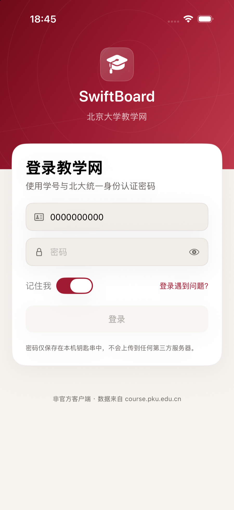

# SwiftBoard

北京大学教学网（course.pku.edu.cn）的非官方 SwiftUI 客户端，同一套代码运行在 **iPhone、iPad 与 Mac** 上。

登录使用北大统一身份认证（IAAA），数据直接来自教学网的 Blackboard Learn 接口，不经过任何第三方服务器。


<p align="center">
  
</p>

> 截图使用演示账号，姓名与学号已替换；仓库中不包含真实课程、成绩或账号信息。

## 功能

- **统一身份认证登录**：RSA 加密密码、token 换取 Blackboard 会话；支持手机令牌与图形验证码；登录状态与 Cookie 保存在钥匙串中，重启无需重复登录。
- **首页概览**：本学期课程数、30 天内截止的作业/任务、最新课程通知、课程封面网格。
- **课程**：按学期分组、全部学期切换、搜索；课程详情包含内容、通知、成绩、信息四个分页。
- **课程内容**：文件夹逐层浏览，文件下载进度，系统 Quick Look 预览，分享 / 保存到「文件」。
- **课程通知**：多课程聚合、按课程筛选、搜索；正文使用 WebKit 渲染，支持图片、表格与深色模式。
- **成绩**：本学期课程成绩总览、已发布成绩 / 已获得分数、逐项得分与完成度；数据来自 Blackboard 的 `gradebook/users/me` 接口。
- **原生体验**：iPhone 使用 Tab 栏，iPad / Mac 使用 `NavigationSplitView`；支持深色模式、动态字体、下拉刷新、键盘快捷键、Quick Look 与分享。
- **离线缓存**：最近一次课程、通知与截止日期快照会缓存在本地，弱网启动时先显示缓存再同步。


## 技术结构

```
SwiftBoard/                    SwiftUI App（iOS + macOS 单一 multiplatform target）
  App/                         App 入口、AppModel、Router、下载中心
  Features/                    Login / Home / Courses / Announcements / Grades / Settings
  UI/                          主题、通用组件、HTML WebView
  Resources/                   Info.plist、entitlements、Assets（含 AppIcon）
SwiftBoardKit/                 本地 Swift Package，可独立测试
  Sources/SwiftBoardKit/
    Auth/                      IAAA 登录、RSA PKCS#1、钥匙串凭据
    Core/                      HTTP、CookieVault、Keychain
    API/                       Blackboard 模型与接口
  Sources/bbprobe/             开发用命令行探针（登录 / 课程 / 下载）
  Tests/                        Swift Testing 单元测试
scripts/make_icon.swift        生成 App 图标
project.yml                    XcodeGen 工程描述
```

### 使用的接口

| 用途 | 接口 |
| --- | --- |
| 登录公钥 | `GET https://iaaa.pku.edu.cn/iaaa/getPublicKey.do` |
| 登录换 token | `POST https://iaaa.pku.edu.cn/iaaa/oauthlogin.do` |
| 建立 Blackboard 会话 | `GET https://course.pku.edu.cn/webapps/bb-sso-BBLEARN/execute/authValidate/campusLogin?token=…` |
| 用户信息 | `GET /learn/api/v1/users/me` |
| 课程列表 | `GET /learn/api/v1/users/me/memberships?expand=course` |
| 学期 | `GET /learn/api/v1/terms` |
| 课程内容 | `GET /learn/api/v1/courses/{id}/contents` 与 `…/contents/{id}/children` |
| 通知 | `GET /learn/api/v1/courses/{id}/announcements` |
| 成绩项 | `GET /learn/api/v1/courses/{id}/gradebook/columns` |
| 我的成绩 | `GET /learn/api/public/v2/courses/{id}/gradebook/users/me` |
| 文件下载 | `/bbcswebdav/...`（携带同一会话 Cookie） |

## 构建

需要 macOS + Xcode（Swift 6、iOS 18 / macOS 15 SDK）以及 [XcodeGen](https://github.com/yonaskolb/XcodeGen)。

```bash
# 生成工程
xcodegen generate
open SwiftBoard.xcodeproj

# 或直接命令行构建
xcodebuild -project SwiftBoard.xcodeproj -scheme SwiftBoard \
  -destination 'platform=macOS' -configuration Debug build

xcodebuild -project SwiftBoard.xcodeproj -scheme SwiftBoard \
  -destination 'platform=iOS Simulator,name=iPhone 17 Pro' -configuration Debug build
```

在 Xcode 中首次运行时：

- iOS 模拟器无需 Team，Xcode 会自动使用 “Sign to Run Locally” 签名；**请保持签名开启**，未签名的模拟器构建无法写入钥匙串，登录状态将不会持久化。
- iOS 真机需要在 *Signing & Capabilities* 中选择自己的 Team。
- macOS 同样使用 “Sign to Run Locally” 即可，沙盒会请求网络访问权限。

运行单元测试：

```bash
swift test --package-path SwiftBoardKit
```

重新生成图标：

```bash
swift scripts/make_icon.swift /tmp/icon.png
```

## 开发探针

`bbprobe` 用同一套 `SwiftBoardKit` 直接访问真实服务，便于验证登录与接口：

```bash
# 读取工作目录下的 .bb_account / .bb_password（已在 .gitignore 中排除）
swift run --package-path SwiftBoardKit bbprobe login
swift run --package-path SwiftBoardKit bbprobe summary
swift run --package-path SwiftBoardKit bbprobe content _123456_1
swift run --package-path SwiftBoardKit bbprobe download _123456_1 _654321_1 /tmp/downloads
```

也支持 `BB_USERNAME` / `BB_PASSWORD` 环境变量。

调试构建还支持以下环境变量（仅 `#if DEBUG`）：

| 变量 | 作用 |
| --- | --- |
| `SWIFTBOARD_ACCOUNT` / `SWIFTBOARD_PASSWORD` | 启动时自动登录 |
| `SWIFTBOARD_ROUTE` | `tab:courses`、`course:<id>:grades`、`content:<courseID>:<contentID>` |
| `SWIFTBOARD_PREVIEW` | 启动后下载并 Quick Look 预览指定文件 |
| `SWIFTBOARD_DEMO` | 将姓名 / 学号替换为演示数据，便于截图 |
| `SWIFTBOARD_FORCE_CAPTCHA` | 强制显示图形验证码输入框（调试 UI） |
| `SWIFTBOARD_HISTORY` | 打开作业详情时自动展示提交记录 |
| `SWIFTBOARD_HISTORY_PREVIEW` | 自动预览第一条提交记录中的文件 |
| `SWIFTBOARD_RESET` | 清除登录状态，展示登录页 |
| `SWIFTBOARD_SNAPSHOT`（macOS） | 将窗口内容渲染为 PNG（无需录屏权限） |

## 安全与隐私

- 账号密码只保存在本机 **钥匙串**（`kSecAttrAccessibleAfterFirstUnlockThisDeviceOnly`），不上传第三方。
- Cookie 快照同样保存在钥匙串；退出登录会清除 Cookie、凭据与缓存。
- 所有请求直连 `iaaa.pku.edu.cn` 与 `course.pku.edu.cn`，使用 HTTPS。
- 仓库中不包含任何真实账号凭据；`.bb_account` / `.bb_password` 已被 `.gitignore` 排除。
- 这是一个学生作品，与北京大学、Blackboard 官方无关。

## 已知限制

- 作业提交目前支持**单个文件 + 可选留言**；多文件、小组作业、在线测试、讨论板等仍需跳转教学网网页。
- 提交记录来自 Blackboard 成绩册的 attempts 接口；通过 Turnitin 等外部工具提交的作业，记录可能不会显示在这里。
- 作业提交严格按教学网 Original 表单字段实现，但本次开发**没有进行真实提交测试**（按需求约定）；首次使用时建议先拿一个非关键作业、小文件验证，并提交后在教学网核对记录。
- 短信验证码需要网页登录；手机令牌（OTP）与图形验证码已在客户端支持。
- 成绩与通知依赖教学网接口，若学校升级 Blackboard 可能需要适配。
- 无推送通知；截止日期来自成绩册中带 `dueDate` 的项目。

## 致谢

- [pku3b](https://github.com/sshwy/pku3b) —— 对 PKU Blackboard 接口的探索提供了重要参考。
- [Blackboard Learn](https://www.blackboard.com/) 与北京大学教学网提供的服务。
- 图标与界面使用 SF Symbols 和系统字体绘制。
